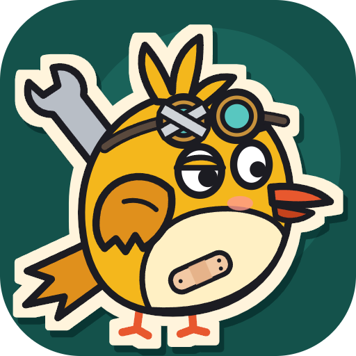

<div align="center">



# FreeBird

**A team of AI bots you chat with like coworkers, running on your own computer.**

Local models through Ollama (or any local runtime) · any API provider with your own key · no account, no subscription

[](https://github.com/00Ahmad/FreeBird/actions/workflows/ci.yml)
[](LICENSE)
[](https://github.com/00Ahmad/FreeBird/stargazers)
[](https://github.com/00Ahmad/FreeBird/network/members)

[Getting started](docs/getting-started.md) · [Features](docs/features.md) · [Races & Clusters](docs/races-and-clusters.md) · [Models & providers](docs/models-and-providers.md) · [Docs](docs/README.md)

</div>

---

FreeBird is a free, open-source desktop app in the style of xAI's **Grok Bot**: a messaging app where every contact is an AI bot with its own tools, files, browser, computer, memory and routines. Bots work in parallel, hand work to each other, and ask before they do anything risky.

The difference: **FreeBird runs on your machine.** Point it at [Ollama](https://ollama.com) and every bot shares one local model, with nothing leaving your computer. Or give any bot a cloud model from OpenAI, Anthropic, Google, Groq, xAI, Mistral, DeepSeek, OpenRouter and more, using your own API key.

On top of that, FreeBird adds things Grok Bot doesn't have, like **Races** (several bots compete on the same task and a judge builds the best answer) and **Clusters** (a moderated, source-checked debate between bots).

> ⭐ **If FreeBird is useful to you, please star the repo.** It helps other people find it. Forks, issues and pull requests are very welcome: see [Contributing](CONTRIBUTING.md).

## Why FreeBird

|                                                                             | FreeBird | Grok Bot |
| --------------------------------------------------------------------------- | :------: | :------: |
| Bots as contacts, group chats, bots handing work to each other              |    ✅    |    ✅    |
| Approval cards before risky actions, a vault for logins                     |    ✅    |    ✅    |
| Routines (schedules, webhooks), connected apps, a computer per bot          |    ✅    |    ✅    |
| **Runs on local models** (Ollama, LM Studio, vLLM, llama.cpp, Jan, LocalAI) |    ✅    |    ❌    |
| **Any API provider** with your own key, a different model per bot           |    ✅    |    ❌    |
| **No account or subscription**; works offline with a local model            |    ✅    |    ❌    |
| **Races**: bots compete, a judge scores them and compiles the best result   |    ✅    |    ❌    |
| **Clusters**: a moderated debate where every claim needs a source           |    ✅    |    ❌    |
| **Memory you can read, edit and import**                                    |    ✅    |    ❌    |
| Open source (MIT)                                                           |    ✅    |    ❌    |

<sub>Grok Bot column based on xAI's public documentation at the time of writing. FreeBird is an independent project, not affiliated with or endorsed by xAI.</sub>

## What you can do with it

### 🏁 Races: let bots compete

Give one task to 3–5 bots. Each picks its own strategy and works alone, on the shared model or each on a different model. Then a judge bot picks the criteria that matter for the task, scores every racer in a table, names a winner and compiles a **final result from the best parts of each**, marking which racer each part came from. Great for writing, research, plans and comparing models head to head. [Read more](docs/races-and-clusters.md#races)

### 🕸️ Clusters: a debate that checks its sources

Describe a topic and a goal (**explore ideas**, **reach a decision** or **research a question**). FreeBird proposes a team of 3–5 bots with different roles, or you pick them. A moderator chooses who speaks next; every claim must be backed by a page the bot actually opened, or by reasoning someone could check, and links the bots never opened are flagged. You can pause, step, steer or stop at any time, and you get a structured summary at the end. [Read more](docs/races-and-clusters.md#clusters)

### 🤝 A Chief of Staff that builds its own team

Your primary bot is a coordinator. When a job splits into independent parts (comparing products, checking several sites), it **creates helper bots on its own**, gives each a task, runs them at the same time and combines their answers. Helpers' approvals and questions show up in your chat. [Read more](docs/features.md#coordinators-and-helpers)

### And everything else you'd expect

- **Real tools with approvals:** files in each bot's own folder, terminal commands, web pages, a real browser (Edge/Chrome) you can watch and take over, web search, and its own Docker desktop computer.
- **Visual Bots** that browse by looking at screenshots and clicking, like a person.
- **Group chats** of 2–6 bots with @mentions; **bot-to-bot messages** in readable threads.
- **Routines:** weekly schedules, intervals, one-time runs, webhooks, and "Teach a task".
- **Connect apps** through any MCP server, with per-tool toggles.
- **Vault** for logins, cards and contact info in your OS keychain; passwords never reach the model.
- **Memory, skills and templates:** see and edit what each bot remembers, save `/skills`, share a bot as a template.
- **Voice:** dictation and read-aloud. **Library:** keep the replies worth keeping.
- **Command palette** (Ctrl+K), keyboard shortcuts, light and dark themes.

See the full [feature guide](docs/features.md).

## Quick start

You need **[Node.js 24+](https://nodejs.org)**, **[pnpm 10](https://pnpm.io/installation)** and, for local models, **[Ollama](https://ollama.com/download)**.

```sh
git clone https://github.com/00Ahmad/FreeBird.git
cd FreeBird
pnpm install
pnpm dev
```

The app opens, finds Ollama (and starts it if needed), lets you pick or download a model, and creates your first bot. Pick a **tool-capable model of 4B or more**: `qwen3.5:9b` and `nemotron-3-nano:4b` are tested. 1B models are unreliable with tools.

Prefer a cloud model? Open **Settings → Models & Providers**, add a key and pick a model. Full walkthrough: [Getting started](docs/getting-started.md).

**Windows installer:** `pnpm package` builds `apps/desktop/release/FreeBird-Setup-<version>.exe`. On macOS and Linux, run from source for now.

## Documentation

| Guide                                              | What's in it                                                                                    |
| -------------------------------------------------- | ----------------------------------------------------------------------------------------------- |
| [Getting started](docs/getting-started.md)         | Install, first run, choosing a model, your first bot                                            |
| [Feature guide](docs/features.md)                  | Every feature: chats, tools, approvals, browser, computer, routines, apps, vault, memory, voice |
| [Races & Clusters](docs/races-and-clusters.md)     | The two multi-bot modes FreeBird adds                                                           |
| [Models & providers](docs/models-and-providers.md) | Local runtimes, cloud providers, the shared model, performance tuning                           |
| [Privacy & security](docs/privacy-and-security.md) | What stays local, how approvals and secrets work                                                |
| [Architecture](docs/architecture.md)               | How the desktop shell, UI, harness and engine fit together                                      |
| [Development](docs/development.md)                 | Building, testing, evals, packaging, project layout                                             |
| [Troubleshooting & FAQ](docs/troubleshooting.md)   | Common problems and answers                                                                     |
| [Roadmap](docs/roadmap.md)                         | What's done and what's next                                                                     |

## How it works, in one picture

```
Electron shell ── loads ── React UI
      │                       │  HTTP commands + one SSE event stream (token-protected, 127.0.0.1 only)
      └── starts ──────► Harness (local server) ── engine (agent loop) ── tools · approvals · routines
                               │
                               ├── shared local model runtime ── Ollama / LM Studio / vLLM / llama.cpp
                               ├── cloud providers ── OpenAI · Anthropic · Gemini · Groq · xAI · …
                               └── SQLite store · OS keychain vault · browser · Docker computer
```

One local model serves every bot: it stays loaded, every request uses the same options so it never reloads, and a priority queue shares it fairly (your chats first, then routines, then background work). Details in [Architecture](docs/architecture.md).

## Privacy

Everything lives on your computer: chats, bots, memory and files in a local SQLite database and folders, secrets in your OS keychain. With a local model, nothing leaves your machine. FreeBird has no telemetry and no account. When you choose a cloud model, only that bot's conversation goes to the provider you picked. See [Privacy & security](docs/privacy-and-security.md).

## Contributing

FreeBird is young and there's lots to do: new providers, macOS and Linux installers, Playwright end-to-end tests, translations, docs and more. Start with [CONTRIBUTING.md](CONTRIBUTING.md) and the open items in the [roadmap](docs/roadmap.md).

- 🐛 Found a bug? [Open an issue](https://github.com/00Ahmad/FreeBird/issues/new/choose).
- 💡 Have an idea? [Suggest a feature](https://github.com/00Ahmad/FreeBird/issues/new/choose).
- 🍴 Want to build on it? Fork it: it's MIT licensed.
- ⭐ Like it? Star it so others can find it.

## License

[MIT](LICENSE). FreeBird is an independent project and is not affiliated with xAI. "Grok" is a trademark of its owner and is used here only to describe the app FreeBird is modelled on.
